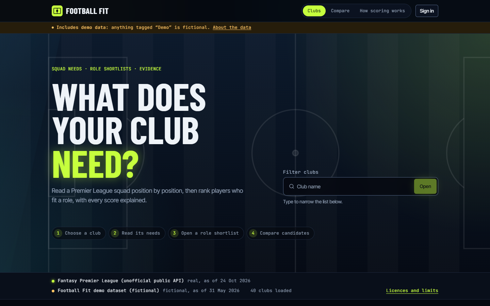
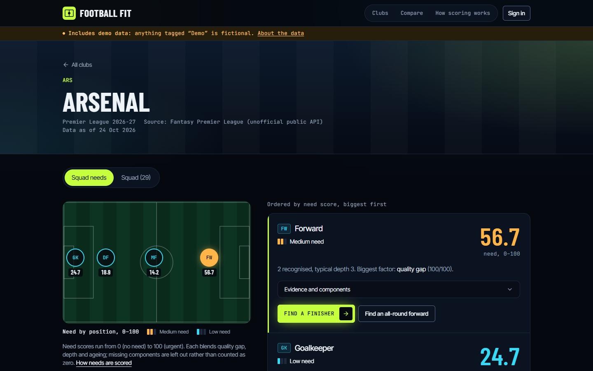
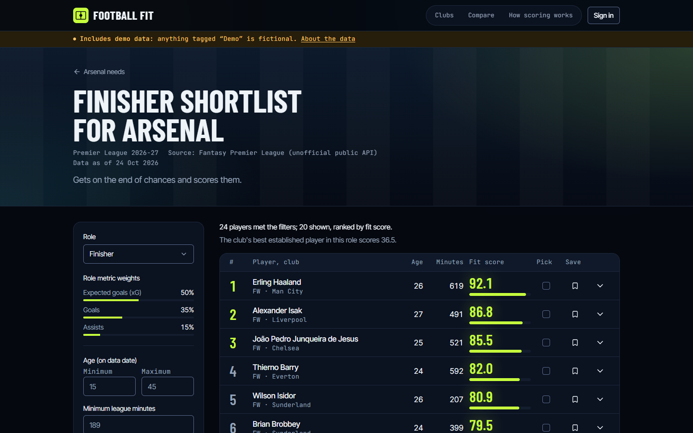
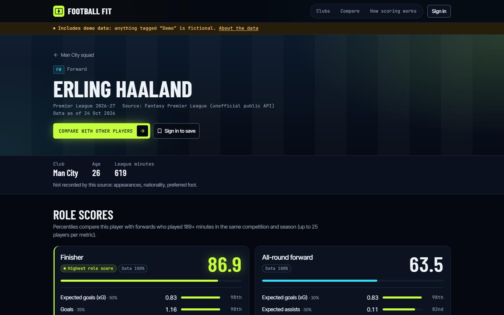
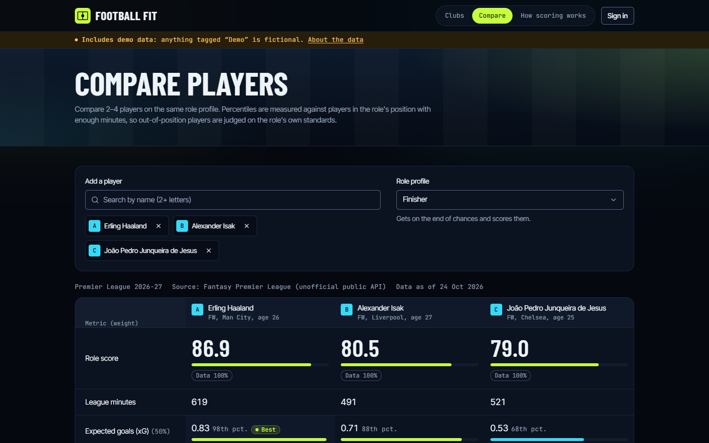
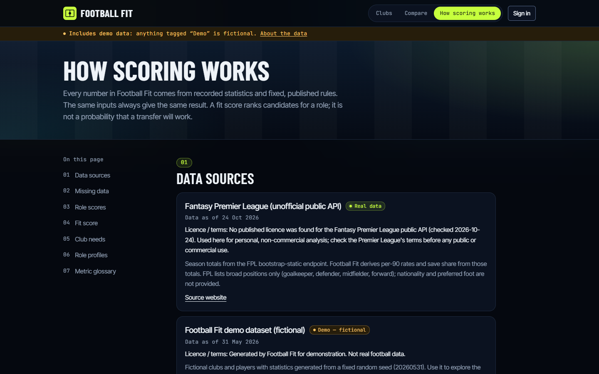
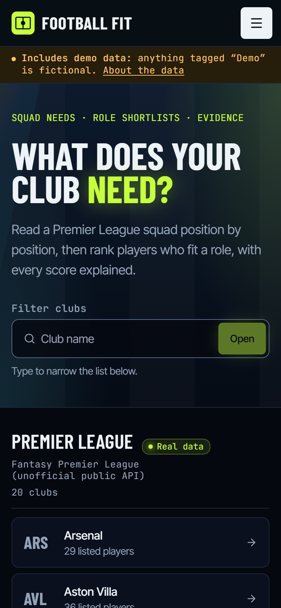
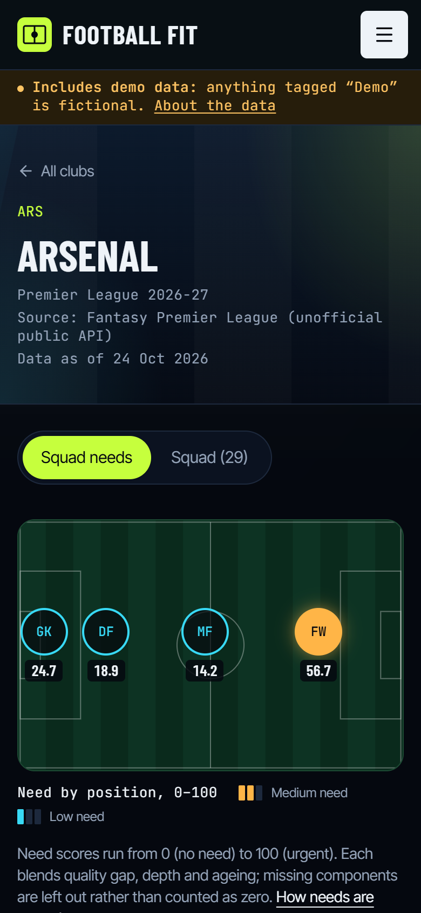
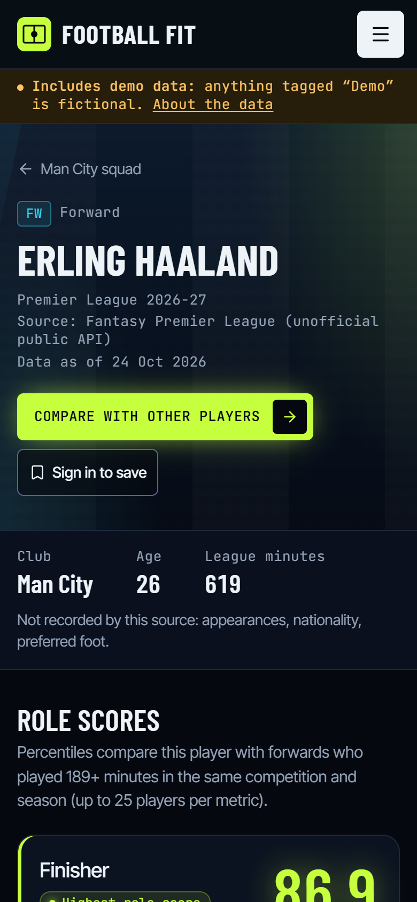

# Football Fit

Football Fit is a Premier League–focused squad-fit site. It reads a club's squad position by
position, explains where it is short, and ranks players who fit a specific role using
transparent, role-specific scoring. Every number comes from recorded statistics and fixed,
published rules. A fit score is a ranking aid, not a prediction that a transfer will work.

The core journey: **choose a club → understand its needs → browse a reasoned shortlist →
inspect player evidence → compare candidates**, with optional accounts for saving shortlists.

## Highlights

- **Explainable, deterministic scoring.** Role-specific metric weights, position-relative
  percentiles and data-coverage flags. Every score on screen shows the evidence behind it.
- **Honest about missing data.** Missing values stay missing, never zero. Each source's licence
  and as-of date is shown. Fictional demo data is labelled everywhere it appears.
- **Full-stack TypeScript + Python.** A typed React client with TanStack Query talks to a Django
  REST API, with JWT accounts (djoser + Simple JWT) for saved shortlists.
- **Real data pipeline.** An FPL importer, a validated CSV importer that checks the whole file
  before writing, and a seeded demo-league generator.
- **Tested and linted.** pytest covers scoring, needs analysis, importers and API behaviour.
  Vitest covers the UI and URL-driven filters. Ruff and oxlint run on both codebases.
- **Responsive and accessible.** Labelled controls, keyboard-friendly interactions, and phone
  layouts for every page.

## Screenshots

Captured from a local run with Premier League data imported from the FPL public API
(data as of 24 Oct 2026).

**Choose a club** — the landing page, with every data source and its date listed up front.



**Understand its needs** — each position gets a 0–100 need score built from quality gap,
depth gap and ageing, with the evidence behind it.



**Browse a reasoned shortlist** — players ranked by fit score for a specific role, with the
role's metric weights and working filters alongside.



**Inspect player evidence** — role scores, per-metric values and percentiles, data coverage,
and an explicit note of what the source does not record.



**Compare candidates** — 2–4 players side by side on the same role profile.



**How scoring works** — the full method, licences and role weights, generated from the API.



**Responsive on phones**

<p>
  
  
  
</p>

## Data sources

| Source | What it is | How to load |
| --- | --- | --- |
| **Fantasy Premier League (FPL) public API** | Real, current Premier League players with season totals (minutes, goals, assists, xG/xA, tackles, recoveries, clearances/blocks/interceptions, saves, goals conceded, clean sheets). | `python manage.py import_fpl` |
| **Fictional demo league** | Generated clubs, players and statistics from a fixed seed, for exploring the product. Clearly labelled “Demo” everywhere. | `python manage.py seed_demo` |
| **Your own licensed CSV** | Any data you are licensed to use, in the schema below. | `python manage.py import_players_csv …` |

Important limits:

- The FPL API is **unofficial** and no published licence was found for it (checked 2026‑10‑24).
  It is labelled as such in the app and is suitable for personal, non-commercial use only.
  Check the Premier League's terms before any public or commercial use.
- FPL records **broad positions only** (goalkeeper, defender, midfielder, forward). Football Fit
  never guesses detailed positions; FPL data is scored with broad-position role profiles.
- Per-90 rates and the goalkeeper “save share” are **derived** by Football Fit from FPL totals.
- Missing values are shown as “Not recorded” and are never treated as zero.

## Stack

- **Backend:** Django 5 + Django REST Framework, djoser + Simple JWT, MySQL 8
  (SQLite fallback for quick local runs)
- **Frontend:** React 19 + TypeScript + Vite, Tailwind CSS + shadcn/ui, TanStack Query, React Router

```
backend/
  config/       settings, URLs
  football/     data model, metric catalogue, demo generator, FPL and CSV importers
  scouting/     role profiles, scoring engine, needs analysis, public API
  shortlists/   saved shortlists for signed-in users
frontend/src/
  api/          typed API client and TanStack Query hooks
  auth/         JWT session handling
  pages/        club picker, needs, shortlist, player, compare, methodology, account pages
docs/           implementation plan, database setup
```

## Getting started

Prerequisites: Python 3.12+, Node 20.19+ or 22.12+, MySQL 8 (optional for a quick try).

### Backend

```bash
cd backend
python -m venv .venv
.venv\Scripts\activate          # macOS/Linux: source .venv/bin/activate
pip install -r requirements-dev.txt
copy .env.example .env           # macOS/Linux: cp .env.example .env — then edit it
python manage.py migrate
python manage.py import_fpl      # real Premier League data (one request)
python manage.py seed_demo       # optional fictional demo league
python manage.py runserver
```

Database configuration is described in [docs/database.md](docs/database.md). Without any
`DB_*` or `DATABASE_URL` setting, a local SQLite file is used.

### Frontend

```bash
cd frontend
npm install
npm run dev                      # http://localhost:5173, proxies /api to localhost:8000
```

Set `VITE_API_PROXY` to proxy to a different backend in development, or `VITE_API_BASE_URL`
to call an API on another origin from a production build (and add that origin to
`CORS_ALLOWED_ORIGINS`).

## Checks

```bash
# backend (runs on MySQL when configured; `DB_NAME= python -m pytest` uses SQLite)
cd backend && python -m pytest && ruff check . && ruff format --check .

# frontend
cd frontend && npm test && npm run lint && npm run build
```

## How scoring works (summary)

The full, live explanation — including every role profile's weights — is on the
**How scoring works** page, generated from `/api/meta/`.

- **Percentiles:** each metric is ranked against players in the same position, competition and
  season with enough minutes (900, or 30% of the most minutes played so far early in a season).
  Lower-is-better metrics are flipped.
- **Role score (0–100):** weighted mean of the available percentiles for a role profile.
  **Coverage** is the share of the profile's weight that has data; below 70% is flagged.
- **Fit score (0–100):** 60% role quality, 25% upgrade over the club's best current player in
  that role, 15% minutes reliability. Missing components are left out and the rest rescaled.
- **Club needs (0–100):** 45% quality gap (league rank of the club's best established player),
  35% depth gap (players who have played vs typical usage), 20% minutes played by players
  aged 31+.

## CSV import schema

`python manage.py import_players_csv players.csv --source-slug my-feed --source-name "My feed" --as-of 2026-05-31 --licence "Licensed for …"`

Required columns: `club, player, position, season`. Optional: `date_of_birth` (YYYY‑MM‑DD),
`nationality`, `secondary_positions` (`;`-separated), `preferred_foot`, `competition`,
`appearances`, `minutes`, and any metric key from `backend/football/metrics.py`.
Positions: `GK CB FB DM CM AM W ST` (detailed) or `DF MF FW` (broad). Blank cells stay missing.
The whole file is validated before anything is written.

## API overview

| Endpoint | Auth | Purpose |
| --- | --- | --- |
| `GET /api/meta/` | – | Data sources, positions, metrics, role profiles, scoring constants |
| `GET /api/clubs/`, `/api/clubs/{slug}/` | – | Club list; club squad with best role scores |
| `GET /api/clubs/{slug}/needs/` | – | Position needs with components and evidence |
| `GET /api/clubs/{slug}/recommendations/?role=…` | – | Filtered shortlist (`max_age`, `min_age`, `min_minutes`, `include_low_coverage`, `include_secondary`, `limit`) |
| `GET /api/players/`, `/api/players/{slug}/` | – | Player search; player evidence |
| `GET /api/compare/?players=a,b&role=…` | – | Side-by-side role comparison |
| `POST /api/auth/users/`, `/api/auth/jwt/create/`, `/api/auth/jwt/refresh/` | – | Register, sign in, refresh |
| `GET /api/auth/users/me/` | JWT | Current user |
| `/api/me/shortlists/…` | JWT | Saved shortlists (CRUD, add/remove players) |
